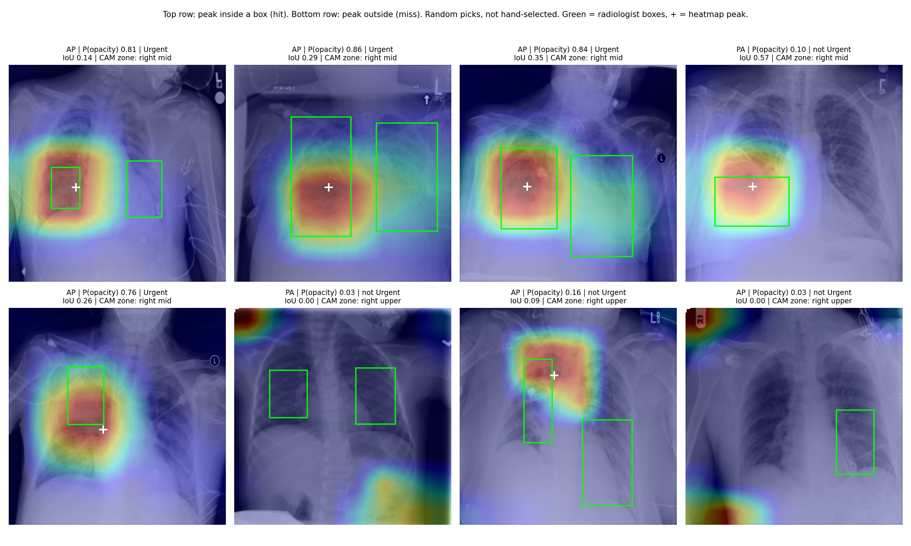
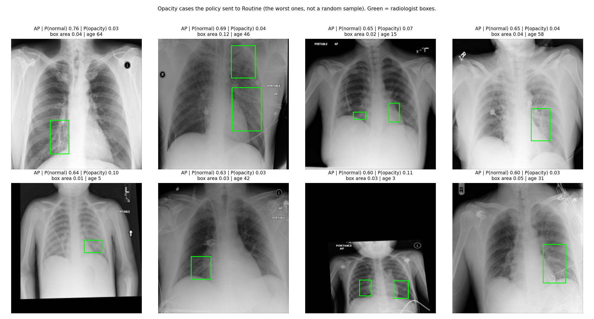

# CXR-Triage Copilot

**Safety-aware chest X-ray triage: a calibrated model, a frozen decision policy with explicit safety targets, a transparent clinical-rules layer, and an honest audit of its explanations.**
A research prototype built on the RSNA Pneumonia Detection Challenge data.

> **Not a medical device.** This is an educational/research prototype. It does not diagnose, prescribe or replace a clinician. India's Telemedicine Practice Guidelines (2020) do not allow AI platforms to counsel patients or prescribe medicines, so the language-model component planned for this project may only *explain* computed results and never suggest drugs or doses.

---

## Overview

Chest X-ray queues are long, and urgent cases can wait behind routine ones. This project routes each scan to **Routine / Review soon / Urgent** and is evaluated on the question that matters for prioritisation: *how many pneumonia-like cases does the system wrongly send to Routine, and how many scans can it safely deprioritise?*

Built and tested so far:

1. a leak-free data pipeline and an audit that found a label shortcut (AP/PA view),
2. a pretrained DenseNet121 compared with a from-scratch CNN and a view-only baseline,
3. calibrated probabilities and a triage policy with per-view thresholds, frozen **before** the test set was touched,
4. a single evaluation on a held-out test set,
5. an audit of Grad-CAM explanations against radiologist boxes (with a baseline and a sanity check),
6. an error analysis of the cases the system misses,
7. the frozen imaging policy as importable code, a sourced clinical-rules layer (CRB-65 and red flags) and an escalate-only fusion step, all unit-tested.

## Scope and honesty: what this is and is not

- **The triage levels are a proxy we defined.** The dataset labels describe findings (Normal / No Lung Opacity-Not Normal / Lung Opacity), not clinical urgency. Mapping them to Routine / Review soon / Urgent is our assumption, not a clinical standard. "Urgent recall" therefore means recall of opacity-labelled cases.
- **The safety targets (flag at least 80% of opacity cases, send at most 2% to Routine) are policy choices**, not medical standards. On the test set the 2% target was met overall and in AP films but not in PA films, and Urgent recall (78.5%) was slightly below 80%.
- **The evaluation is retrospective, on one curated dataset.** Its class mix is not a hospital queue, so workload figures such as "22% of scans deprioritised" will not transfer to real practice. There is no external validation yet.
- **Explanations are weak.** Grad-CAM heatmaps depend on what the model learned but localise no better than a typical-location guess, so they are used only for scans flagged Urgent and described as "the area the model focused on".
- **The clinical rules use UK guidance** (BTS, NHS, Asthma + Lung UK) and have not been reviewed by a clinician. Local guidance may differ.
- **The language-model explainer is not built yet.** Only the rules, the fusion step and (in progress) the knowledge base exist.
- Research prototype only; not for clinical use.

## Status

| Component | Status |
|---|---|
| Data audit and leak-free split | Done |
| Baselines (view-only, small CNN) | Done |
| DenseNet121 transfer learning + view-balanced ablation | Done |
| Calibration and per-view triage thresholds | Done |
| Grad-CAM audit vs radiologist boxes | Done |
| Error analysis | Done |
| Final test-set evaluation (single run) | Done |
| Imaging policy as code, clinical rules (CRB-65 + red flags), escalate-only fusion, unit tests | Done |
| Knowledge cards and retrieval | In progress |
| Explain-only LLM (Gemini API) with output verifier | Planned |
| Evaluation harness for the LLM layer (safety, faithfulness, retrieval) | Planned |
| API and demo | Planned |
| External validation on a second dataset | Planned (optional) |

## Triage mapping

| Dataset class | Triage level |
|---|---|
| Normal | Routine |
| No Lung Opacity / Not Normal | Review soon |
| Lung Opacity | Urgent |

The imaging policy: **Urgent** if P(opacity) >= t_urgent; otherwise **Routine** if P(normal) >= t_routine; otherwise **Review soon**. "Routine" is deliberately hard to earn.

## Data

- **Source:** RSNA Pneumonia Detection Challenge (Kaggle), derived from NIH ChestX-ray14. The data is **not included** in this repository.
- **Size:** 26,684 frontal radiographs, one per patient ID; DICOM, 1024x1024.
- **Classes:** Normal 8,851 | No Lung Opacity / Not Normal 11,821 | Lung Opacity 6,012 (9,555 radiologist bounding boxes).
- **Split:** 70/15/15 stratified by class, seed 42: 18,678 train / 4,003 validation / 4,003 test. Every image has a unique patient ID, so the split is leak-free at patient level.
- **Preprocessing:** resized to 256x256, stored as one `uint8` array, ImageNet normalisation, grayscale copied to 3 channels. Training augmentation: rotation up to 7 degrees, random resized crop (scale 0.9-1.0), brightness/contrast jitter; no flips.

### The AP/PA view is a label shortcut

| Class | AP | PA |
|---|---|---|
| Lung Opacity | 0.78 | 0.22 |
| No Lung Opacity / Not Normal | 0.50 | 0.50 |
| Normal | 0.18 | 0.82 |

AP (often bedside, portable) films come disproportionately from sicker patients, so a model can partly "cheat" by learning the view. A classifier using **only** the AP/PA flag reaches macro-F1 0.376. Every result below is therefore reported per view as well.

Other audit notes: all images are MONOCHROME2; sex is balanced across classes; the age field has invalid values (e.g. 153, 155) and some young children, so age is not a model input.

## Method

| Model | Description |
|---|---|
| View-only baseline | Logistic regression on the AP/PA flag only |
| Small CNN | 4 conv blocks from scratch, 8 epochs |
| DenseNet121 | ImageNet-pretrained, dropout 0.2 head, class-weighted cross-entropy, AdamW, OneCycle LR (peak 3e-4), mixed precision, early stopping on validation macro-AUROC, seed 42 |
| DenseNet121 + view-balanced | Same, with sampling weights that equalise every (class, view) group |

## Results

### 1. Model quality

| Model (validation unless noted) | Macro-F1 | Macro-AUROC | Opacity recall (argmax) | PA opacity recall |
|---|---|---|---|---|
| View-only (AP/PA) | 0.376 | - | 0.785 (precision 0.379) | - |
| Small CNN | 0.620 | 0.828 | 0.532 | 0.144 |
| **DenseNet121** | 0.693 | **0.882** | **0.757** | **0.521** |
| DenseNet121 + view-balanced | 0.703 | 0.862 | 0.561 | 0.366 |
| **DenseNet121, held-out test set** | **0.695** | **0.883** | - | - |

On the test set: opacity AUROC 0.887, opacity PR-AUC 0.713 (validation 0.884 and 0.692). The test numbers match validation, so there is no sign of overfitting to the validation set.

**Finding: view-balanced retraining did not help.** It lowered AUROC (0.882 to 0.862) and PA opacity recall (0.521 to 0.366), so the shortcut was handled in the decision layer instead (below). Reported as a negative result.

### 2. Calibration

Class-weighted training makes a model act as if all classes were equally common, which overstates P(opacity). Temperature scaling alone did not fix this; correcting for the real class prior first did.

| P(opacity), validation | ECE | Brier | NLL |
|---|---|---|---|
| Raw | 0.082 | 0.127 | 0.655 |
| Temperature only (T=1.35) | 0.084 | 0.123 | 0.634 |
| Prior correction only | 0.044 | 0.114 | 0.613 |
| **Prior correction + temperature (T=1.25)** | **0.030** | **0.112** | **0.602** |

On the test set the calibrated ECE is 0.028.

### 3. Triage policy

One global pair of thresholds fails the 2% target in PA films, because the model under-reports opacity there:

| Validation | Opacity sent to Routine (AP / PA) | Urgent recall (AP / PA) | Scans sent to Routine |
|---|---|---|---|
| A: global thresholds, 2% target | 0.8% / 6.2% | 0.864 / 0.567 | 32.0% |
| B: global, 1.5% safety margin | 0.4% / 4.6% | 0.864 / 0.567 | 29.9% |
| **C: per-view thresholds, 1.5% margin** | 1.4% / 0.0% (in-sample) | 0.801 / 0.820 | 20.8% |
| D: view unknown (strictest of C) | 0.0% / 0.0% | 0.956 / 0.820 | 16.3% |

In 5-fold out-of-fold checks (thresholds tuned on 4 folds, judged on the 5th), policy C sent 1.8% (AP) and 1.5% (PA) of opacity cases to Routine, versus 4.6% for PA with one global threshold. Policy C was then **frozen**: thresholds AP (t_urgent 0.39, t_routine 0.58), PA (0.12, 0.85); view unknown (0.12, 0.85).

### 4. Final test-set evaluation (single run, frozen policy)

| Policy C, test set | Urgent recall | Opacity sent to Routine | Abnormal sent to Routine | Scans sent to Routine |
|---|---|---|---|---|
| All (n=4,003) | 0.785 (0.758-0.811) | **0.009 (0.003-0.016)** | 0.037 | 0.221 |
| AP films (n=1,879) | 0.788 (0.758-0.818) | 0.003 (0.000-0.007) | 0.033 | 0.109 |
| PA films (n=2,124) | 0.774 (0.716-0.830) | **0.031 (0.010-0.059)** | 0.043 | 0.320 |

Brackets are 95% bootstrap intervals. Reading it honestly:

- The 2% target holds overall (0.9%, upper bound 1.6%) and in AP films, but **not in PA films** (3.1% point estimate; the interval is wide because PA contains few opacity cases).
- Urgent recall (78.5%) is slightly below the 80% target; the interval includes it.
- If the view is unknown, the strictest thresholds catch 93.1% of opacity cases and send 0.7% to Routine, at the price of flagging 49.2% of all scans as Urgent and deprioritising only 18.1%.

### 5. What is in the Urgent group (validation)

Only **2.4%** of Urgent flags are truly normal scans; 48.7% are "Not Normal" (abnormal, but not labelled as opacity) and 49.0% are opacity. Among PA films, 65.4% of Urgent flags are "Not Normal". The system is best read as a prioritisation aid that safely deprioritises about a fifth of the queue, not a sharp urgency detector.

### 6. Grad-CAM audit (validation, 902 opacity images)

| | Grad-CAM | Position prior (where boxes usually sit) | Random point |
|---|---|---|---|
| Peak inside a box | 0.582 (0.552-0.614) | **0.594** | 0.123 |
| IoU at 0.5 x peak | 0.300 | 0.290 | - |
| Peak zone = zone of largest box | **0.455** | 0.350 | - |

- **Sanity check passed:** a randomly initialised network scores 0.041 (peak inside a box) and 0.063 IoU, so the heatmaps depend on what the model learned.
- **But localisation is no better than the position prior** at this coarse 8x8 resolution (0.582 vs 0.594). Heatmaps are only better than the prior at zone level.
- Heatmaps are informative when the case is flagged Urgent (peak inside a box 66.5%) and not when it is missed (23.9%). Explanations should therefore be shown only for Urgent-flagged cases and described as the *area the model focused on*, never as the location of disease.



### 7. Error analysis (validation)

- Missed opacity cases are **smaller and fewer**: median box area 0.052 vs 0.107 of the image, median 1 box vs 2 (both p < 0.0001); age does not differ (p = 0.14).
- 10 of 902 opacity cases were sent to Routine. The 8 worst were all AP films; 7 had a box area of 0.05 or less, and 3 were patients aged 15 or younger (children are rare in this data).



## Clinical-rules layer (built, unit-tested)

Plain Python in `src/clinical/rules.py`; every rule carries its source.

- **CRB-65** (one point each for confusion, respiratory rate of 30 or more, low blood pressure, age 65 or over): 0 = lower risk, 1-2 = hospital assessment should be considered, 3-4 = urgent. Source: British Thoracic Society guideline (via a GPnotebook summary).
- **Oxygen saturation below 92%** is treated as Urgent (same source).
- **Emergency signs** (struggling to breathe, blue or pale lips/skin, sudden confusion or unusual sleepiness, coughing up blood, fainting or collapse) are treated as Urgent. Sources: NHS and Asthma + Lung UK (formerly the British Lung Foundation).
- **Chest pain is deliberately not a rule**, because no sourced threshold was verified; it can be added with a source.
- **Unknown is never normal.** Missing answers add no points, are listed as unknown, and "Routine" cannot be confirmed while confusion, respiratory rate or blood pressure are missing. As a result the app will often answer "Review soon" for users who cannot supply vital signs; this is intentional and configurable.

`src/copilot/fusion.py` combines the imaging level and the clinical level into one auditable "case facts" object. The final level is **never lower than either input** (escalate-only), and a heatmap is allowed only when the imaging level is Urgent. Both properties are covered by unit tests, including a randomised test over thousands of cases.

## Planned: explain-only clinical copilot

A short, paraphrased and cited knowledge base (written from NHS, Asthma + Lung UK and BTS material, with no medicines mentioned) feeds an LLM (Gemini API) that writes a clinician summary and a plain-language explanation from the case facts, behind a verifier that blocks drug names and doses, checks the text against the computed result, and validates citations. The LLM never decides or prescribes. It will be evaluated on synthetic cases and adversarial prompts (red-flag escalation, drug/dose leakage, citation validity).

## Running the tests

```
python -m venv .venv
.venv\Scripts\activate          # macOS/Linux: source .venv/bin/activate
pip install -r requirements.txt
pytest -q
```

## Reproducing the experiments

1. Create a Kaggle account and join the RSNA Pneumonia Detection Challenge (accept the rules).
2. Run the notebooks in `Notebooks/` in order on Kaggle: data preparation (CPU), training (GPU T4, Internet on), triage thresholds and calibration (CPU), Grad-CAM (GPU), and error analysis plus the single test evaluation (GPU).

The competition data is subject to its terms of use and is not redistributed here.

## Repository structure

```
CXR-Triage-Copilot/
├── README.md
├── requirements.txt
├── pytest.ini
├── Notebooks/        (data prep, training, thresholds, calibration, Grad-CAM, error analysis and test)
├── results/          (metrics JSON, figures, comparison CSVs, triage_config_v2.json)
├── src/
│   ├── imaging/      policy.py   (frozen calibration and thresholds)
│   ├── clinical/     rules.py    (CRB-65 and red flags)
│   └── copilot/      fusion.py   (escalate-only case facts)
├── tests/
├── data/knowledge/   (planned: knowledge cards, retrieval check)
└── app/              (planned: API and demo)
```

## Acknowledgements

RSNA and Kaggle for the challenge data; NIH for ChestX-ray14; DenseNet (Huang et al., 2017); Grad-CAM (Selvaraju et al., 2017); NHS, Asthma + Lung UK and the British Thoracic Society for the guidance the clinical rules are based on.

## Author

Abhishek Sharma, B.Tech Artificial Intelligence & Data Science, IIIT Raichur.

## License

Code: MIT (to be confirmed). Data and trained weights follow the terms of the source dataset.
